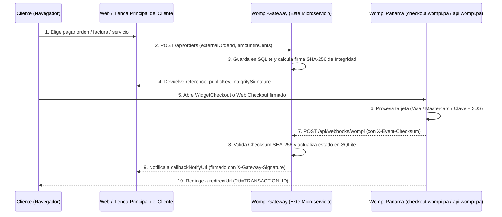

# Informe Completo: Estado y Construcción de Pasarela de Pagos — Wompi Panamá (`HUSTON ASSETS S A`)

Este documento resume la auditoría inicial realizada sobre el portal **comercios.wompi.pa**, detallando qué estaba hecho al inicio, qué faltaba y cómo funciona la arquitectura del microservicio construido en este repositorio.

---

## 1. Diagnóstico Inicial de la Cuenta

| Campo | Estado Verificado |
| :--- | :--- |
| **Razón Social / Comercio** | **HUSTON ASSETS S A** (Sociedad Anónima registrada en Panamá, Folio Nº 819606) |
| **Correo del Comercio** | `shaolinco@gmail.com` |
| **Estado Legal y Bancario** | **APROBADO Y ACTIVO EN PRODUCCIÓN** (listo para cobrar dinero real y recibir desembolsos) |
| **Moneda de Operación** | Dólares estadounidenses (`USD`) — Tarjetas Visa, Mastercard y Clave |
| **Link de Pago Rápido (VPOS)** | Activo: `https://checkout.wompi.pa/l/VPOS_uMNAaw` + Código QR |
| **Llave Pública Producción** | `pub_prod_0vsGidrn72wbGthE9BTTac9P3BXNqat7` |
| **Llave Privada y Secretos** | Emitidos y configurados localmente en `.env` (protegido por `.gitignore`) |
| **Conexión API en Vivo** | **VERIFICADA (`200 OK`)** contra `https://api.wompi.pa/v1` |
| **URL de Eventos (Webhook)** | Pendiente de registrar en `comercios.wompi.pa/developers` cuando se despliegue en dominio `HTTPS` |

---

## 2. Arquitectura Técnica Implementada



---

## 3. Fórmulas de Seguridad Criptográfica de Wompi Panamá

### A. Firma de Integridad (`signature:integrity`)
Calculada en `src/crypto.ts` (`generateIntegritySignature`):
```text
SHA256( reference + amountInCents + "USD" + [expirationTime] + integritySecret )
```
* Evita que un usuario malintencionado modifique el monto o la moneda desde el navegador antes de pagar.

### B. Verificación de Webhook (`X-Event-Checksum`)
Calculada en `src/crypto.ts` (`verifyWebhookChecksum`):
1. Se recorren en orden estricto las rutas declaradas en `event.signature.properties` dentro de `event.data`.
2. Se concatenan sus valores seguidos de `event.signature.timestamp` y el `eventsSecret`.
3. Se calcula `SHA-256` en hexadecimal y se compara en tiempo constante (`crypto.timingSafeEqual`) contra el header `X-Event-Checksum`.

---

## 4. Acciones de Seguridad Pendientes en el Portal Wompi

1. **Activar la Doble Verificación (2FA)** en la pantalla de `Inicio` de `comercios.wompi.pa`.
2. **Cambiar la contraseña del portal** por seguridad operativa.
3. **Crear un usuario con rol técnico** en `Roles y Usuarios` si terceros necesitan consultar transacciones sin acceso administrativo total.
4. **Activar el Modo de Pruebas (Sandbox)** en `Desarrollo -> Programadores` para obtener las llaves `pub_test_...`, `prv_test_...`, `test_integrity_...` y `test_events_...` antes de ejecutar pruebas de cobro simuladas.
